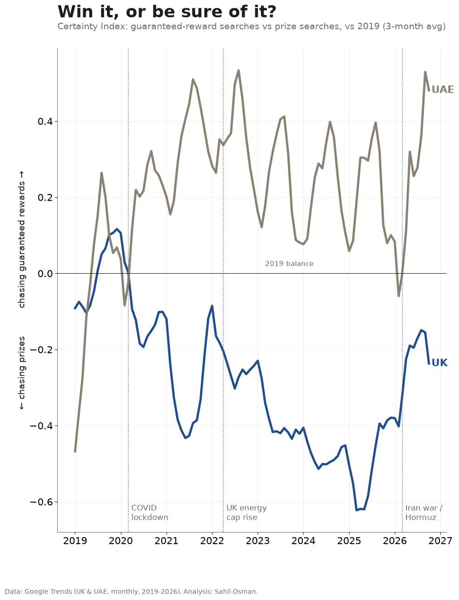
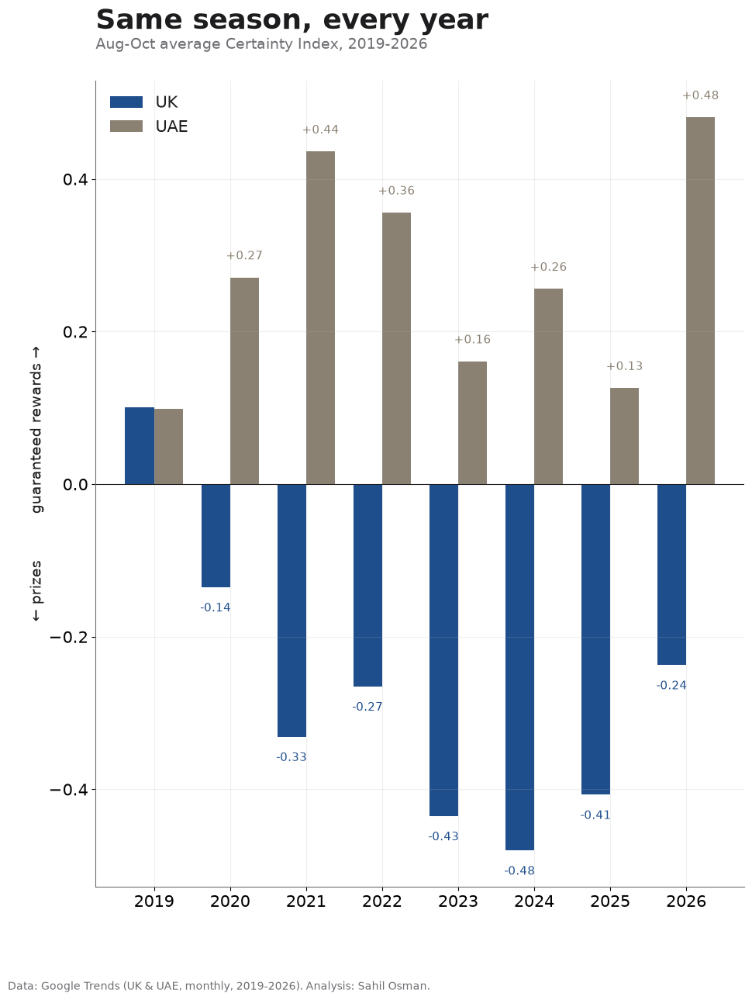
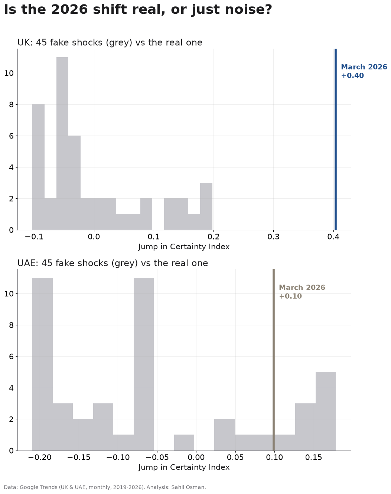
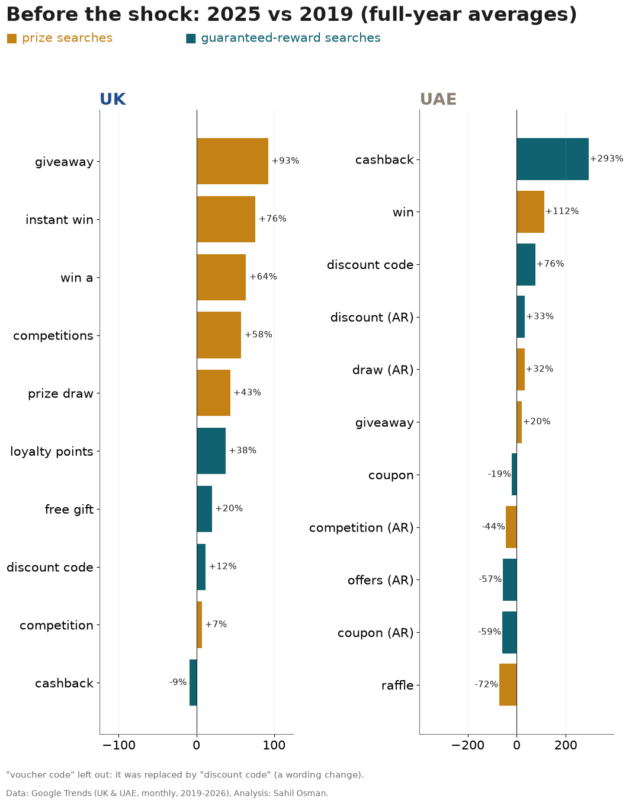
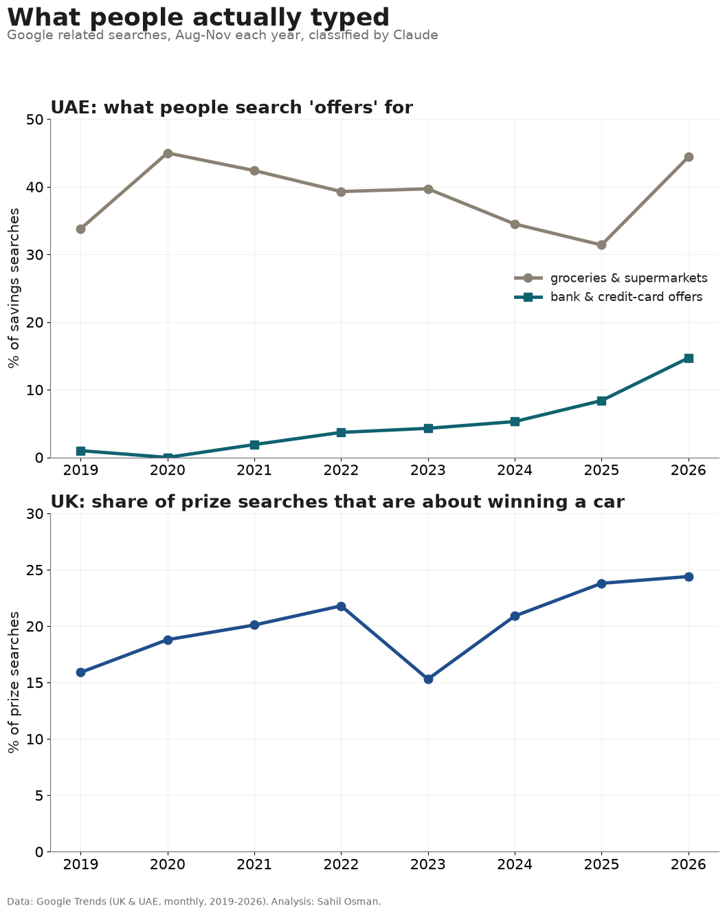

# Win it, or be sure of it?
### How economic shocks change what persuades shoppers: UK vs UAE, 2019-2026



---

## The 60-second version

When money gets tight, do people stop chasing the *chance* to win something big and start wanting something *guaranteed*, like cashback, discounts or loyalty points?

I measured this across 8 years and 2 countries, using 32 Google search terms (English and Arabic) and 669 real search queries classified by AI.

**What I found:**

1. **In a slow squeeze, UK shoppers moved towards prizes, not away from them.** Between 2019 and 2025, before the shock, prize searches grew by 57% on average and guaranteed-reward searches by 15% (full-year averages across all tracked terms, voucher codes left out). "Giveaway" +93%, "instant win" +76%, against loyalty points +38% and cashback −9%. The 2022 cost-of-living crisis didn't reverse it. When things feel stuck, a small chance at something big seems to hold its appeal.
2. **A sudden shock swung it back.** When the 2026 Iran war closed the Strait of Hormuz and fuel and energy prices jumped, the UK made its **biggest swing towards guaranteed rewards since at least 2021**, once seasonal patterns are accounted for. Cashback searches jumped to twice their winter level within a month (average 45 in Dec-Feb, 91 in Mar-Sep). In 45 placebo tests with fake shock dates (60 in an extended check covering Sep 2020 to Aug 2025), nothing came close.
3. **The country nearest the war moved more gradually.** Same war, two routes: the UAE was hit directly, the UK through fuel and energy prices. On the same measure, UK cashback searches jumped within a month (54 in February, 89 in March), while UAE cashback searches climbed steadily to a peak in August (55 in March, 100 in August; UAE cashback was already rising before 2026). Across all terms, the UAE drifted towards certainty after March 2026 and partly bounced back after the April ceasefire. By the same season, UAE "offers" searches had turned to **groceries and bank and credit-card offers**: bank offers rose from 1% of savings searches in 2019 to 15% in 2026.

**Why it matters:**

| Circle | Who | So what |
|---|---|---|
| Wider | Marketing, retail, finance | A gradual squeeze and a sudden shock change behaviour in *opposite* directions. Look at what kind of pressure people are under, not just how much. |
| Industry | Promotions and loyalty teams | Guaranteed mechanics (cashback, points) rise after sudden shocks. Prize mechanics held up through slow ones. |
| Inner | Prize promotions | Demand for chance didn't die in the cost-of-living crisis. It grew, and car prizes took a bigger share (16% to 24% of UK prize searches). |

---

## Results

### 1. The Certainty Index
`CI = ln(guaranteed-reward searches vs 2019) − ln(prize searches vs 2019)`. Above 0 means attention shifted towards guaranteed rewards. A move of +0.48 means guaranteed-reward searching grew about 60% faster than prize searching.

**Same season (Aug-Oct), every year**, which is how the promotions industry compares years:

| | 2019 | 2020 | 2021 | 2022 | 2023 | 2024 | 2025 | **2026** |
|---|---|---|---|---|---|---|---|---|
| UK | +0.10 | −0.14 | −0.33 | −0.27 | −0.44 | −0.48 | −0.41 | **−0.24** |
| UAE | +0.10 | +0.27 | +0.44 | +0.36 | +0.16 | +0.26 | +0.13 | **+0.48** |
| UK without "voucher code" | +0.11 | −0.13 | −0.29 | −0.18 | −0.31 | −0.32 | −0.24 | **−0.07** |



### 2. Measuring the shocks (interrupted time series, Newey-West errors, month and Ramadan controls)

| Country | Shock | Immediate jump | 95% CI | p |
|---|---|---|---|---|
| UK | COVID lockdown (Mar 2020) | −0.20 (towards prizes) | −0.35 to −0.05 | 0.007 |
| UK | Energy cap rise (Apr 2022) | +0.02 | −0.15 to +0.19 | 0.81 |
| UK | **Iran war energy shock (Mar 2026)** | **+0.48** | **+0.37 to +0.60** | **<0.001** |
| UAE | Strikes begin (Mar 2026) | +0.11, then +0.05/month trend | −0.00 to +0.22 | 0.05 (trend p = 0.015) |
| UAE | Ceasefire (Apr 2026) | −0.21 (partial bounce-back) | −0.40 to −0.03 | 0.02 |

**Is the UK jump real?** I re-ran the model with a fake shock at each of 45 months between 2021 and 2024. The largest fake jump was 0.20, half the real one. Extending the test to every month from Sep 2020 to Aug 2025 (60 fake dates, `outputs/tables/placebo_extended.csv`) gives a largest fake jump of 0.16. The UAE jump sits inside its placebo range, so I treat the UAE result as a gradual drift, not a clean break.



**Robustness.** The UK 2026 jump stays between +0.32 and +0.57 (all p < 0.001) when I drop cashback (banks pushed cashback cards hard in 2026), drop the generic "win" terms, drop prize-platform terms, drop voucher and discount codes, or use English terms only (`outputs/tables/robustness.csv`). The COVID shift towards prizes is significant in 7 of 8 versions (−0.16 to −0.34). It shrinks to −0.14 and becomes borderline (p = 0.07) without "giveaway" and "competitions", the terms most tied to the growth of online prize-competition sites, so part of the UK prize boom reflects that industry growing, not only shopper mood.

**UAE vs UK.** The difference-in-differences estimate is +0.03 (p = 0.79): the overall *size* of the 2026 shift isn't significantly different between the two countries, partly because the UK was also hit, through energy prices. What differs is the *timing*: UK cashback searches jumped within a month, while UAE cashback searches climbed until August. Same war, two routes.

### 3. What moved before the shock, term by term (2025 vs 2019)



### 4. What people actually typed (LLM content analysis)
669 unique Google "related searches", from 8 seed terms × 8 years × 2 countries, classified by Claude against a fixed codebook.



---

## Method

| Layer | Technique | Plain English |
|---|---|---|
| Data | Google Trends API, each term collected on its own 0-100 scale, Jan 2019 to Oct 2026 | What millions of people searched for |
| Index | Log change vs own 2019 baseline, averaged per side | One number: "be sure" vs "win" |
| **LLM** | **Claude, few-shot classification against a versioned codebook** (`config/codebook_queries.yaml`): reward type, object, money pressure | AI read every query and labelled it |
| **Unsupervised** | Character n-gram TF-IDF → NMF topics (k = 8), compared with Claude labels | Let the data group itself first |
| **Supervised** | Logistic regression on character n-grams, trained on Claude's labels, 5-fold CV | A cheap model that copies the AI |
| **Regression** | Interrupted time series (segmented OLS, HAC errors) + difference-in-differences + event study | How much did each shock move people? |
| Validation | Placebo shocks, 6 robustness variants, Ramadan control, keyword-rule baseline | Trying hard to prove myself wrong |

**ML results**

| Model | Agreement with Claude |
|---|---|
| Logistic regression (learned from Claude) | 91.2% accuracy, κ = 0.87, macro-F1 = 0.84 |
| Hand-written keyword rules | 73.1% accuracy, κ = 0.58 |
| Unsupervised clusters | ARI = 0.24 (clusters group by *spelling*, e.g. "win 10" sits with "scratch and win") |

The gap between keyword rules and Claude is the case for using an LLM. Rules can't tell "competition law" or a "BMW M4 Competition" from a radio prize competition. The distilled model shows those labels can then be applied at scale for almost nothing.

### Design decisions worth knowing
- **Each term is collected alone.** In a shared request Google rounds small terms to 0, so I measure each term's *change* against its own 2019 level instead of comparing volumes.
- **Aug-Oct, not Aug-Nov.** 2026 has no complete November yet, and November contains Black Friday, so the comparison is like for like.
- **Ramadan control.** Ramadan moves about 11 days a year, and Ramadan 2026 (about 18 Feb to 19 Mar) overlapped the start of the war. Without the control, Ramadan effects would be credited to the war.
- **Dropped terms:** "اربح" (Arabic for "win": 22 of 94 months were zero) and "clubcard prices" (its 2020 launch spike swamps everything).
- **"Voucher code" is a wording trap.** It fell from 71 to 33 between 2019 and 2025 (March-September averages) while "discount code" rose from 48 to 55: people kept looking for codes but stopped calling them vouchers. Because it sits in the index, it makes the UK's slow drift towards prizes look about a third bigger than it is (Aug-Oct 2024: −0.48 with it, −0.32 without). The direction and every shock estimate hold without it, so it stays in the main index for transparency and the robustness table reports both.
- **Reward mix from neutral seeds only.** A query found under "cashback" is about cashback by construction, so the mix is measured on "deals", "offer(s)" and "عروض" only.

### Limitations
- **Searches are attention, not purchases.** Google Trends is sampled and relative.
- **Supply moves demand.** Banks pushed cashback products in 2026 and prize-competition platforms grew through 2020-25, so some of the shift is marketing, not mood. The cashback robustness check addresses part of this.
- **Arabic deal searches are in long decline**, consistent with a shift to English and to apps. English-only results are reported alongside the main index.
- **The UAE series is lower-volume and noisier** than the UK's.
- **Two countries make a comparative case study.** The difference-in-differences design is not proof of causation.
- **The query labels were produced by Claude (Opus 5.5) in a single pass**, checked against keyword rules and a distilled model but **not yet against a human-labelled sample**. See `docs/labelling_guide.md` to add one.
- **2026 related queries for "offer(s)" contain generic noise** ("jobs", "vegetables"); these are labelled `none`.

---

## Run it

```bash
pip install -r requirements.txt
python run_pipeline.py     # rebuilds every table and chart from data/raw in about 10 seconds
```
Re-collecting the data: see `docs/data_collection.md`. To re-label with the Claude API: `python -m cvc.label_queries --label` (needs `ANTHROPIC_API_KEY`).

```
config/      terms.yaml · shocks.yaml · codebook_queries.yaml       ← every research decision
data/raw/    trends_long.csv · related_rows_compact.txt
data/labels/ query_labels_claude_compact.txt                         ← Claude's 669 labels, editable
src/cvc/     collect_trends · index · regress · placebo · robustness · parse_related · label_queries · ml_queries · charts
             (+ collect_posts, label_llm, validate, topics, distil: optional social-post extension, not used in v1)
video/       render.py: draws the LinkedIn video from the same data
outputs/     tables/*.csv · charts/*.png (1080×1350, LinkedIn-ready)
```

*Independent personal research using public data only. Not affiliated with or endorsed by my employer.*
